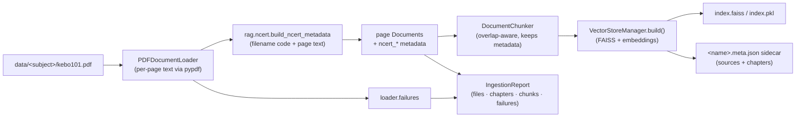

# Knowledge Base Architecture

How NEETra AI turns **chapter-wise NCERT PDFs** into a grounded, citation-ready
retrieval index — and how each chapter keeps its identity (subject, class,
title) all the way to the answer.

The knowledge base is built on the **existing** FAISS stack
(``rag.vector_store.VectorStoreManager``). NCERT-awareness is **additive**: a new
metadata layer (`rag/ncert.py`) enriches the documents the generic loader already
produces. Nothing about embeddings, chunking, the index format or search changed.

---

## 1. Pipeline



`store.search()` later filters on the lowercase ``subject`` key and returns
``RetrievedChunk`` objects whose metadata still carries the chapter title, class
and source — so answers can cite *"The Living World · Class 11 · NCERT"*.

---

## 2. Folder layout

```text
data/
├── physics/     keph101.pdf … keph108.pdf
├── chemistry/   kech101.pdf …
└── biology/     kebo101.pdf  kebo102.pdf   ← Class 11 NCERT chapters
```

* The **folder** sets the retrieval subject (`biology` → `subject="biology"`).
* The **filename code** (`kebo101`) sets class + chapter number.
* The **PDF text** supplies the human chapter title.

Any of the three may be missing; the extractor combines what is present and
falls back gracefully (see §3–4).

---

## 3. Chapter identification — `rag/ncert.py`

Pure and offline (stdlib + `utils.constants` only): no pypdf, torch, LangChain,
OCR or network. It reads the page **text** the loader already extracted.

### Filename codes

`[class][medium][subject][NNN]`

| Token      | Values                          | Meaning                  |
|------------|---------------------------------|--------------------------|
| class      | `k` → Class 11, `c` → Class 12  | the leading letter       |
| medium     | `e` English, `h` Hindi          | kept, not branched on     |
| subject    | `ph`/`ch`/`bo` (`bi`,`zo`)      | Physics/Chemistry/Biology |
| `NNN`      | leading digit(s) = volume, **last two = chapter number** | `101` → chapter 01 |

Descriptive names are also understood — e.g. `Class-11-Biology-Chapter-5-Plant-Kingdom`.
Anything else returns `None`, and the loader keeps its original, non-NCERT path.

### Title extraction (content first, catalogue second)

Tried in order against the first pages:

1. inline `Chapter N: <Title>` / `Chapter N - <Title>`;
2. a `Chapter N` line whose **next** line is the title;
3. a lone ALL-CAPS heading;
4. fallback: a built-in **Biology catalogue** (Class 11 & 12, rationalised NCERT
   titles) keyed by chapter number;
5. last resort: `Chapter N`.

Titles are normalised to Title Case (shouty ALL-CAPS is softened, small words
kept lowercase).

### Stored metadata

Each page/chunk of a recognised chapter gains **additive, scalar** keys — the
retrieval-critical `subject` (lowercase) and `source` (relative path) are never
overwritten, so the existing search/citation/catalog code keeps working:

```json
{
  "ncert": true,
  "ncert_subject": "Biology",
  "ncert_source": "NCERT",
  "class": "11",
  "chapter": "The Living World",
  "chapter_number": 1,
  "book_code": "kebo101"
}
```

The **report and sidecar** render the canonical five-field shape required of the
feature:

```json
{ "subject": "Biology", "class": "11", "source": "NCERT",
  "chapter": "The Living World", "file": "kebo101.pdf" }
```

---

## 4. The ingestion report

`IngestionReport` counts **files processed, pages, chunks created, chapters
found, and per-file failures**. A file that is unreadable, or that yields no
text, is recorded under `failures` (with the error) instead of aborting the run —
one corrupt chapter never blocks the rest of the bookshelf.

`report.markdown()` renders:

* a summary table (files · pages · chunks created · added · duplicates ·
  **chapters found** · **failures** · duration);
* a **Chapters** table (`subject | class | chapter | file`);
* a **Failures** table (`file | error`).

The same data is written to `KB_INGESTION_REPORT.md` / `.json`, and the chapter
list is mirrored into the index sidecar (`<name>.meta.json → "chapters"`) so the
Learn/Practice modules can list real chapters **without loading FAISS**.

---

## 5. Commands

```bash
# via the app (writes KB_INGESTION_REPORT.{md,json})
python app.py --ingest                 # rebuild from data/
python app.py --ingest --ingest-append # index only new chapters
python app.py --ingest --source data/biology

# standalone (same pipeline, explicit report paths)
python scripts/ingest_kb.py
python scripts/ingest_kb.py --source data/biology --report out.md --json out.json

# the original module entry point still works, now NCERT-aware + --report/--json
python -m rag.ingest --rebuild
```

All three delegate to `rag.ingest.run_ingestion`, so behaviour is identical.

---

## 6. Backward compatibility

* `rag/ncert.py` is **new**; nothing else is required to import it.
* The loader only enriches files that carry an NCERT code/descriptor — ordinary
  PDFs/TXT/MD are byte-for-byte unchanged in their metadata.
* `VectorStoreManager`, `DocumentChunker`, embeddings, search and citations are
  untouched. `IngestionReport` only **adds** fields (`chapters`, `failures`);
  `as_dict()` keeps every previous key.
* `scripts/offline_check.py` never imports the heavy RAG modules, so NCERT logic
  stays testable offline (see `tests/test_ncert_ingestion.py`).

Out of scope by design: web search, OCR, hybrid search. Scanned (image-only)
PDFs are surfaced as a failure with an explicit "run OCR first" message rather
than silently producing an empty chapter.

---

## 7. Extending

* **Another subject's catalogue:** add a list to `_BIOLOGY_TITLES`'s sibling map
  and pass it in `_catalogue_title` — content extraction still takes priority.
* **New filename schemes:** extend `_CODE_RE` / add a `_descriptive_*` pattern.
* **Richer per-chapter data** (e.g. page ranges): thread it through
  `NcertMetadata.to_document_metadata()`; retrieval and the sidecar pick it up
  automatically because metadata flows chunk → index → search unchanged.
