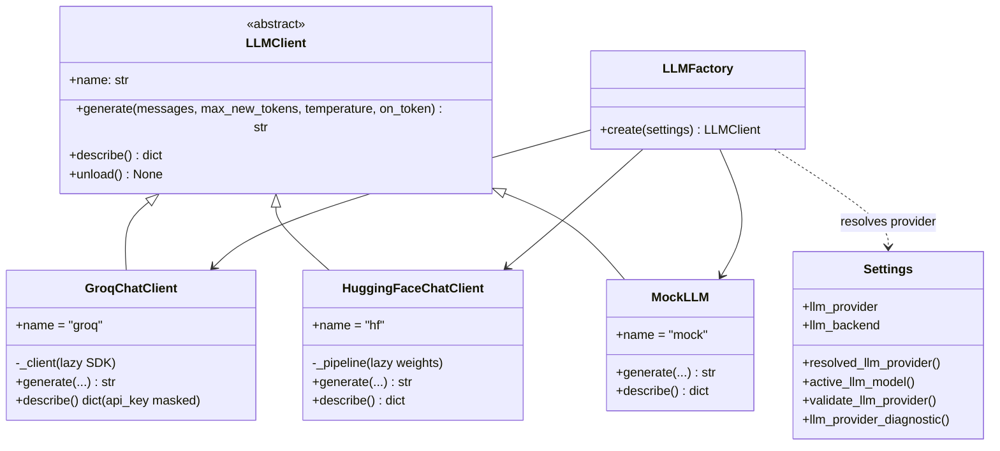
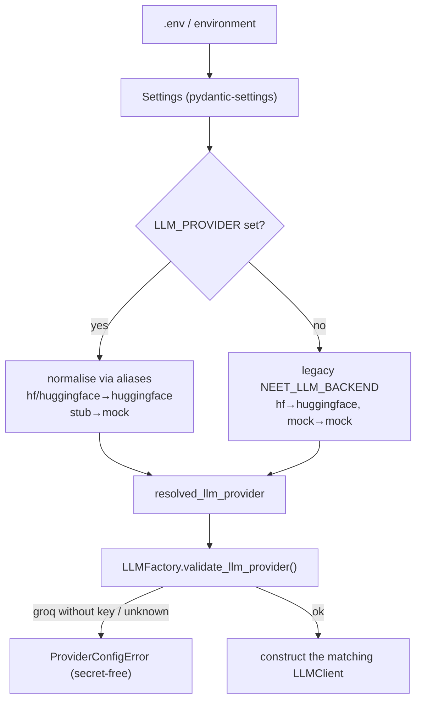

# Provider Architecture

NEETra AI talks to a language model through a single abstraction so that **no
application code cares which provider is active**. Swapping Groq for a local
HuggingFace model, or either for the offline mock, is a configuration change —
never a code change in the agents, learning services or UI.

```text
LLMClient  (abstract contract — llm/base.py)
├── GroqChatClient          hosted, OpenAI-compatible  (llm/groq_client.py)
├── HuggingFaceChatClient   local transformers model   (llm/huggingface_client.py)
└── MockLLM                 deterministic, offline     (llm/mock_client.py)
            ▲
            │ created by
     LLMFactory.create(settings)   ← reads settings.resolved_llm_provider
```

---

## 1. Class diagram



The contract each provider implements (`llm/base.py`):

```python
def generate(
    self,
    messages: Sequence[ChatMessage],        # {"role": ..., "content": ...}
    *,
    max_new_tokens: int | None = None,
    temperature: float | None = None,
    on_token: TokenCallback | None = None,  # streaming; still returns full text
) -> str: ...
```

All providers raise `LLMError` (never a raw SDK exception) so the agent layer can
turn a failure into a friendly chat message instead of a traceback.

---

## 2. Configuration flow



Provider selection is **prefix-free** on purpose, so a `.env` reads naturally.
Because `Settings` uses `env_prefix="NEET_"` with `extra="ignore"`, a
`validation_alias` bypasses the prefix for exactly the provider keys:

| Purpose              | Environment variable                          | Prefix |
|----------------------|-----------------------------------------------|--------|
| Choose provider      | `LLM_PROVIDER` = `groq` \| `huggingface` \| `mock` | none |
| Groq key             | `GROQ_API_KEY`                                | none   |
| Groq model           | `GROQ_MODEL` (default `qwen/qwen3.8-27b`)       | none   |
| Groq sampling        | `GROQ_TEMPERATURE` / `GROQ_TOP_P` / `GROQ_MAX_TOKENS` | none |
| **Legacy** provider  | `NEET_LLM_BACKEND` = `hf` \| `mock`           | `NEET_` |
| Legacy HF model      | `NEET_LLM_MODEL`                              | `NEET_` |

---

## 3. Provider selection rules

1. **`LLM_PROVIDER` wins when set.** It is trimmed, lower-cased and mapped
   through the alias table (`hf`/`hugging_face` → `huggingface`, `stub` → `mock`).
2. **Otherwise the legacy `NEET_LLM_BACKEND` decides** (`hf` → `huggingface`,
   `mock` → `mock`). Every pre-provider `.env` therefore keeps working untouched.
3. **Unknown spellings are not silently coerced.** They pass through
   `resolved_llm_provider` so `validate_llm_provider()` raises one clear
   `ProviderConfigError` — instead of the property throwing during logging.
4. **Startup validation is fail-fast and secret-free.** `LLM_PROVIDER=groq`
   without `GROQ_API_KEY` raises before any SDK is touched; a `groq` or
   `huggingface` provider with a blank model (`GROQ_MODEL` / `NEET_LLM_MODEL`)
   also raises. `LLMFactory.create` and `app.py --check` both run this check.

### Secret hygiene

- The API key is **never printed**. Diagnostics expose it only through
  `mask_secret()`, which keeps the last four characters (`...1239`) and returns
  `not set` for empty values.
- `GroqChatClient.describe()`, `Settings.llm_provider_diagnostic()` and the
  `--check`/sidebar panels all route the key through the mask.
- Validation messages name the variable (`GROQ_API_KEY`) and point to
  `console.groq.com`, but never echo its value.

### Health check / `--check`

`app.py --check` reports the **provider** and **active model** (and a masked key
for Groq) without loading any weights or touching the network:

```text
"llm": { "provider": "groq", "model": "llama-3.3-70b-versatile",
         "api_key": "...1239", "configured": true, "loaded": false }
```

---

## 4. Migration guide

Backward compatibility is total: existing deployments that only set
`NEET_LLM_BACKEND` continue to work with no changes.

### Keep using a local model (no change needed)

```ini
NEET_LLM_BACKEND=hf
NEET_LLM_MODEL=Qwen/Qwen2.5-7B-Instruct
```

### Move to Groq (recommended for development)

```ini
LLM_PROVIDER=groq
GROQ_API_KEY=gsk_...        # required; get one at console.groq.com
GROQ_MODEL=llama-3.3-70b-versatile
GROQ_TEMPERATURE=0.2
GROQ_MAX_TOKENS=2048
```

Install the SDK (already listed in `requirements.txt`; it is imported lazily so
`--check` and the offline tests run without it):

```bash
pip install groq
```

### Offline / CI (no models, no network)

```ini
LLM_PROVIDER=mock
```

### Choosing Groq but forgetting the key

```text
ProviderConfigError: LLM_PROVIDER=groq requires GROQ_API_KEY. Set it in your
environment or .env file (never commit .env); get a key at console.groq.com.
Alternatively use LLM_PROVIDER=huggingface for a local model or LLM_PROVIDER=mock
for offline testing.
```

### Rule of thumb for adding a fourth provider

1. Add its fields + `validation_alias` keys to `Settings`.
2. Add its canonical name and aliases to `PROVIDERS` / `_PROVIDER_ALIASES`.
3. Implement a new `LLMClient` subclass (`generate`/`describe`/lazy load).
4. Add one branch in `LLMFactory.create`.

Nothing above the factory — agents, learning services, UI — changes at all,
because they only ever receive an `LLMClient`.
